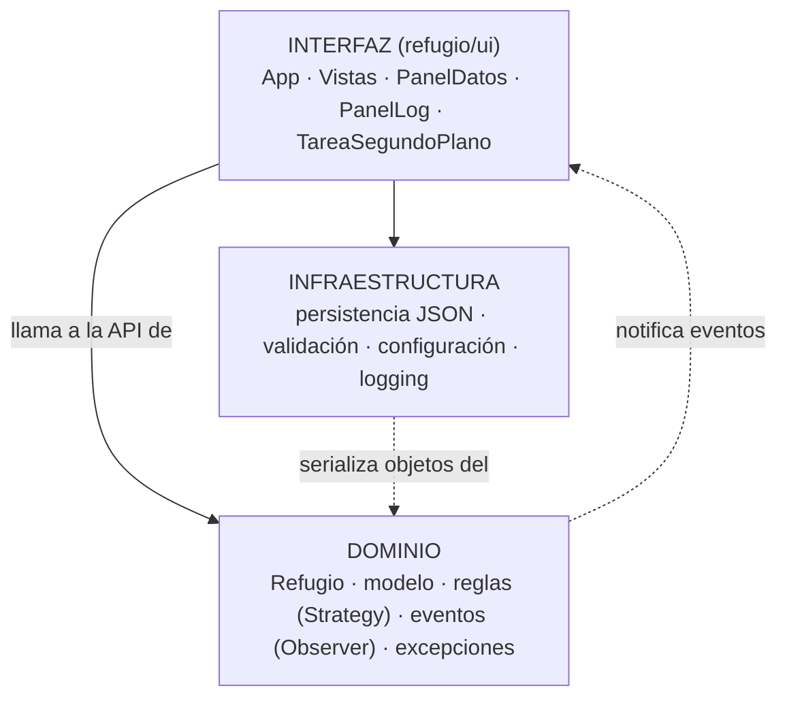

# Refugio - Sistema de gestión de refugio de animales

## Descripción del proyecto

Aplicación de escritorio (Python + tkinter) para gestionar un refugio de animales: animales, vountarios y adopciones. Proyecto hecho en grupo (Grupo 1) para la asignatura *Técnicas de Programación Avanzada* (Universidad de Nebrija).

## Funcionalidad

- **Animales:** registrar ingresos, ver el listado y eliminar animales; el estado de adopción está validado y la capacidad del refugio es 24.
- **Voluntarios:** alta, modificación y baja; asignar o desvincular animales, con un máximo de animales por voluntario.
- **Adopciones:** tramitas, modificar y cancelar. Se comprueban las reglas de negocio y los errores se muestran en la ventana.
- **Panel de datos generales**, que se actualiza solo cuando cambia el refugio.
- **Panel de log** en la propia ventana.
- **Guardar y cargar datos** desde la interfaz, sin bloquear la ventana. Al cargar se descartan los registros inválidos (con copia `.bak`).
- **Modo demo** con datos precargados y **modo real** con persistencia propia y autoguardado al cerrar.
- **Configuración** mediante `config.json`.

## Instalación y ejecución

Requisitos: **Python 3.11 o superior** con tkinter.

```bash
pip install -r requirements.txt
```

La aplicación se lanza **desde la carpeta `src/`**:

```bash
cd src
python -m refugio.ui --demo         # datos de demostración. No lee ni escibe archivos de datos
python -m refugio.ui                # modo real: carga y guarda en refugio.json
python -m refugio.ui --config RUTA  # usa otro archivo de configuración especificado en `RUTA`
python .m refugio                   # demo por consola (sin interfaz)
```

**Configuración (opcional).** Copia `config.example.json` a `config.json` (en la carpeta desde la que lanzas la aplicación `src/`) y edítalo: `nivel_log`, `archivo_log`, `nombre_refugio` y `capacidad_maxima`. Las rutas son relativas a esta carpeta. El nombre y la capacidad solo se usan al crear un refugio nuevo. Si falta una clave, se usa su valor por defecto.

## Pruebas y calidad

Desde la raíz del repositorio:

```bash
pytest          # pruebas
pytest --cov    # con cobertura
```

## Arquitectura

Tres capas lógicas. **El dominio no importa nada de `ui/`**: la interfaz depende del dominio, nunca al revés.



- **`Refugio`** (`gestor.py`) es el agregado raíz y el único punto de entrada al dominio: las vistas llaman a sus métodos y nunca tocan sus listas internas.
- **Strategy:** las reglas de negocio (`reglas.py`) son clases intercambiables que `Refugio` recibe por el constructor.
- **Observer:** `Refugio` notifica eventos (`ingreso`, `baja`, `voluntario`, `adopcion`) y el panel de datos se actualiza al recibirlos.
- **Vistas polimórficas:** `Vista` es una clase base abstracta con tres implementaciones (animales, voluntarios y adopciones).
- **Concurrencia:** guardar y cargar corren en un hilo secundario y avisan a la interfaz mediante una cola, porque tkinter solo puede usarse desde el hilo principal.

```text
src/refugio/
├── gestor.py          Refugio (agregado raíz)
├── modelo/            Persona, Voluntario, Adoptante, Animal, Adopcion, RevisionVeterinaria
├── reglas.py          reglas de negocio (Strategy)
├── eventos.py         Observable (Observer)
├── excepciones.py     excepciones propias
├── persistencia.py    guardar y cargar JSON
├── configuracion.py   lectura de config.json
├── demo.py            datos de demostración
└── ui/                interfaz tkinter
```

## Colaboradores

<table>
  <tr>
    <td align="center" width="150">
      <a href="https://github.com/Goblanch">
        <br>
        <sub><b>Gonzalo Blanch Domínguez</b></sub>
      </a>
    </td>
    <td align="center" width="150">
      <a href="https://github.com/Marck497">
        <br>
        <sub><b>Juan Marcos Pairola</b></sub>
      </a>
    </td>
    <td align="center" width="150">
      <a href="https://github.com/meryqMedina">
        <br>
        <sub><b>Maria Quijano Medina</b></sub>
      </a>
    </td>
    <td align="center" width="150">
      <a href="https://github.com/miguelloret03-bit">
        <br>
        <sub><b>Miguel Ángel Lloret Frasquet</b></sub>
      </a>
    </td>
    <td align="center" width="150">
      <a href="https://github.com/hugolkio">
        <br>
        <sub><b>Hugo Fernández Álvarez</b></sub>
      </a>
    </td>
  </tr>
</table>
